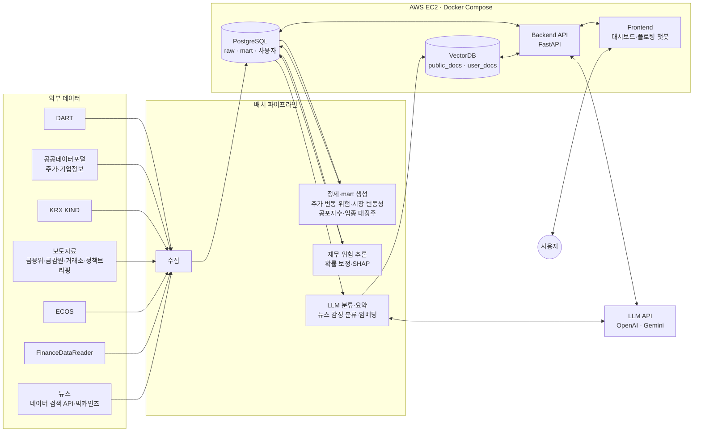

# Stock Canary 기획안
- 기준 문서: `docs/guide/기획안_보유종목_위험점검_v3.md`, `docs/data_spec.md`, `docs/system_architecture.md`, `docs/tech_spec.md`, `docs/screen_spec.md` (develop 브랜치, 2026-11-26 기준)

---

## 1. 주제

| 항목 | 내용 |
|---|---|
| 서비스명 | **Stock Canary** |
| 이름의 뜻 | 탄광의 카나리아처럼 보유 종목의 위험을 먼저 알려 주는 조기 경보 서비스 |
| 한 줄 소개 | 내 보유 종목과 포트폴리오 전체의 위험을 "재무 위험"과 "주가 변동 위험" 두 축의 단계로 점검하고, 뉴스 기반 공포지수와 같은 업종 대장주 비교로 시장·업종 상황을 함께 보여 주며, 공시·보도자료·내 평가 이력을 근거로 질문에 답하는 포트폴리오 점검 챗봇 서비스 |
| 포지셔닝 | 매수·매도·비중 조절을 추천하지 않고 위험 신호와 근거 정보만 제공 (최종 판단은 사용자) |

---

## 2. 사용자·판단

### 2-1. 대상 사용자

- 주식을 잘 모르지만 관심이 있어 국내 주식 3~10종목을 직접 보유한 **직장인 초보 투자자**
- 투자 경력 1~3년 정도, 재무제표·공시를 읽어 본 경험이 거의 없음

### 2-2. 판단 상황

- "내 보유 종목 중 **이번 주에 신경 써서 살펴봐야 할 종목이 있는지, 있다면 왜 그런지, 지난주보다 무엇이 달라졌는지**"

### 2-3. 사용 맥락

| 항목 | 내용 |
|---|---|
| 빈도 | 주 1회 (주말 또는 금요일 퇴근 후) |
| 소요 시간 | 5~10분 안에 점검 완료 |
| 현재 상황 | 평일에는 주가 앱만 가끔 확인. 종목 소식은 뉴스·커뮤니티 글로 뒤늦게 인지하고 공시·보도자료는 직접 읽지 않음 |
| 필요한 것 | 결론 먼저(괜찮은지 / 살펴볼 종목이 있는지), 전문 용어 대신 쉬운 말, 용어 즉시 풀이, 근거는 궁금할 때만 상세 확인 |

### 2-4. 기존 방식의 문제점

| 구분 | 기존 방식 | 문제점 | Stock Canary |
|---|---|---|---|
| 공시 확인 | 종목마다 DART·증권사 앱에서 직접 검색 | 시간이 들고 위험 공시를 놓침 | 보유 종목 위험 공시 자동 수집, 위험 유형별 분류 |
| 당국 발표 확인 | 금융위·금감원·거래소 사이트 개별 확인 또는 뉴스로 뒤늦게 인지 | 제도 변경이 내 종목에 주는 영향을 모름 | 공식 보도자료를 수집해 챗봇에서 검색 |
| 공시·용어 이해 | 원문 직접 해석, 모르는 용어는 따로 검색 | "유상증자", "감사의견 한정", "자본잠식"의 의미를 판단하기 어려움 | LLM 쉬운 말 요약, 화면 용어 풀이, 출처 표시 챗봇 |
| 재무 건전성 판단 | 재무제표 직접 확인 또는 커뮤니티 의견 | 판단 근거가 불명확 | 재무 위험 등급(4단계)과 업종 평균 대비 비교 |
| 주가 위험 판단 | 등락률만 보고 감으로 판단 | "회사가 위태로운지"와 "주가가 출렁이는지"를 구분하지 못함 | 주가 변동 위험 등급(5단계)을 재무 위험과 따로 표시 |
| 시장·종목 분위기 파악 | 뉴스 헤드라인과 커뮤니티 글을 훑어보고 감으로 판단 | 자극적인 기사 몇 개에 휩쓸리고, 지금 분위기가 평소보다 얼마나 나쁜지 모름 | 뉴스 긍정·부정 비율로 계산한 공포지수(시장)와 종목 뉴스 분위기를 과거 대비 위치로 표시 |
| 업종 비교 | 내 종목 주가만 보고 판단 | 주가가 빠졌을 때 업종 전체 문제인지 내 종목만의 문제인지 구분하지 못함 | 같은 업종 시가총액 상위 3개(대장주)와 주가 흐름·위험 등급·재무비율을 나란히 비교 |
| 포트폴리오 점검 | 증권사 앱의 수익률·평가금액 위주 | 업종 쏠림, 고위험 종목 비중을 파악하지 못함 | 위험 등급 분포, 업종 집중도, 변동성·상관, 위험 공시 노출 비중 종합평가 |
| 이력 관리 | 기억이나 메모에 의존 | 지난번 대비 변화를 알기 어려움 | 평가 리포트 저장, 챗봇이 "지난주 대비 변화"를 근거로 답변 |

---

## 3. 데이터

### 3-1. 데이터 출처와 확보 방식

| 데이터 | 출처 | 확보 방식 | 용도 | 갱신 |
|---|---|---|---|---|
| 재무제표, 감사의견 | DART OpenAPI | API | 재무 위험 모델 변수, 라벨 ③ | 분기 |
| 공시 목록·원문 | DART OpenAPI | API | 공시 변수, LLM 위험 유형 분류, RAG | 일 |
| 일별 주가·시가총액 | 공공데이터포털 금융위원회_주식시세정보 | API | 주가 변동 위험 등급, 포트폴리오 변동성, 화면 시세 | 일 |
| 과거 수정주가, KOSPI 지수, 상장폐지 목록·사유 | FinanceDataReader | 라이브러리 | 재무 위험 모델 주가 기반 변수, 시장 변동성 배너, 라벨 ②, 생존 편향 방지 | 수시 |
| 관리종목 지정 이력·사유 | KRX KIND 공시 상세검색 | 크롤링 | 라벨 ①(재무 사유만) | 수시 |
| 투자주의환기, 거래정지, 실질심사, 횡령 등 | KRX KIND 투자유의사항 | 크롤링·엑셀 다운로드 | 재무 위험 규칙 덮어쓰기, 라벨 ④(논의 중) | 수시 |
| 투자주의·경고·위험 | KRX KIND 투자유의사항 | 크롤링·엑셀 다운로드 | 주가 변동 위험 보정 | 일 |
| 기업 기본정보 (업종) | 공공데이터포털 금융위원회_기업기본정보 | API | 업종 평균, 업종 집중도 | 분기 |
| 국고채 금리 | 한국은행 ECOS | API | Merton 부도거리 무위험 금리 | 일 |
| 금융위원회 보도자료 | 금융위원회 홈페이지 | 크롤링 (본문 HTML) | RAG: 제도·규정 변경 | 일 |
| 금융감독원 보도자료 | 금융감독원 보도자료 API | API (본문 텍스트 포함) | RAG: 투자 유의·불공정거래 | 일 |
| 금융감독원 소비자경보 | 금융감독원 홈페이지 | 크롤링 (주식·투자상품 관련만) | RAG: 투자 유의 | 일 |
| 한국거래소 보도자료 | 한국거래소 open.krx.co.kr | 목록 JSON 조회, 본문은 첨부 추출 | RAG: 상장 규정, 시장 관리 | 일 |
| 정부·정책 보도자료 | 정책브리핑(재정경제부, 공정거래위원회) | 크롤링, 본문은 첨부 PDF 추출 | RAG: 경제정책·기업 제재 (선택) | 일 |
| 뉴스 제목·요약 (최근) | 네이버 뉴스 검색 API | API (제목·요약문·링크만 저장, 본문 미수집) | 공포지수, 종목 뉴스 분위기 | 일 |
| 뉴스 (과거 분포용) | 빅카인즈(한국언론진흥재단) | 검색 결과 다운로드 | 공포지수 기준 분포 | 1회 |
| 증권사 투자의견·목표주가 (선택) | 컨센서스 제공 사이트 (출처 확인 필요) | 크롤링 (수치만, 리포트 본문 미수집) | 공포지수 보조 지표, 종목 애널리스트 의견 | 일 |
| 사용자 평가 리포트 | 서비스 내부 생성 | LLM 생성 | 개인 RAG, 지난주 대비 변화 | 평가 시 |

**용도별 데이터 기간**

| 용도 | 기간 |
|---|---|
| 재무 위험 모델 (재무제표·라벨) | 약 10년 (2015 사업연도부터, 기준일 2016~2025년 4월 1일) |
| 주가 변동 위험 등급 기준값 | 최근 5년 롤링 |
| 시장 변동성 배너 기준 | 과거 10년 KOSPI |
| 공포지수 기준 분포 | 최근 3년 뉴스 (확보 가능 기간 확인 후 확정) |
| RAG 보도자료 | 최근 5년 |
| 화면 지표 | 최근 6개월 (주가 차트 1년) |

### 3-2. 확보 가능 여부 확인 결과 (2026-11-25 확인)

| 출처 | 결과 | 확인 내용 |
|---|---|---|
| DART OpenAPI | **확보 가능** | 고유번호 매핑(종목코드 보유 4,021개사, 상장폐지사 포함), 공시 목록, 재무제표(2015 사업연도부터, 연결·별도), 감사의견 조회 정상. 개인 키 일 20,000회 한도로 10년치 수집은 최소 3일 분할 |
| FinanceDataReader | **확보 가능** | 상장폐지 목록 4,229건과 폐지 사유 컬럼(2015년 이후 주권 결측 0건). 2015년 이후 폐지 593종목 주가 전부 수신(수정주가). KOSPI 2000년부터 수신. 출처가 네이버 시세라 내부 분석·학습용으로만 사용 |
| KRX KIND | **조건부 확보 가능** | 클라우드 IP에서는 접속 차단, 팀원 PC(국내 IP)에서 수집 확인. 관리종목 메뉴는 현재 지정분만 제공하므로 과거 이력은 공시 상세검색으로 수집(2015-01 ~ 2026-11 관리종목 관련 공시 2,396건). 투자주의·경고·위험(2005년부터), 실질심사법인(2008년부터), 횡령 등(2005년부터)은 이력 조회 가능 |
| 금융위원회 홈페이지 | **확보 가능** | 기간·페이지 조회 가능, 상세 페이지에 본문 HTML 제공, robots.txt 전체 허용 |
| 금융감독원 | **확보 가능 (인증키 신청 필요)** | 보도자료 API가 본문 텍스트까지 제공. 소비자경보는 홈페이지 본문 HTML 제공. 원문 링크 사용 시 금감원에 링크 통지 필요 |
| 한국거래소 보도자료 | **확보 가능** | 2000년부터 목록 조회, 본문은 HWP·PDF 첨부에만 존재. 원문 재게시는 사전 동의 대상이라 서비스에는 가공 결과와 원문 링크만 표시 |
| 정책브리핑 | **확보 가능** | 부처 코드(재정경제부 `A00041`, 공정거래위원회 `C00001`)로 기간 조회 가능. 본문은 첨부에만 존재, 텍스트는 공공누리 제1유형 |
| 한국은행 ECOS, 기업기본정보 | 미확인 | 발표 전 시험 호출 예정 |
| 네이버 뉴스 검색 API | 미확인 | 검색어당 최대 1,000건까지만 조회되어 과거 분포 산출에는 부족. 주간 갱신용으로 사용, 종목명 동음이의어 필터 필요 |
| 빅카인즈 | 미확인 | 과거 뉴스 기간·건수 제한과 이용 조건 확인 필요 |
| 증권사 컨센서스 | 미확인 | 이용 조건상 자동 수집 허용 여부 확인 필요. 불가하면 선택 기능(F-32) 제외 |

**부실 라벨 확보 결과 (최근 10년)**

| 구분 | 12개월 창 | 15개월 창 |
|---|---|---|
| 재무 사유 관리종목 (감사의견 비적정 포함) | 480 | 541 |
| 재무 사유 상장폐지 | 114 | 167 |
| 합계 (기준일 10개 시점) | **584** | **688** |

- 기준일당 양성 41~90개로 시간 순 검증에 필요한 표본 확보
- 남은 결정: "상장폐지사유 발생" 중 원인 불명 건, 정기보고서 미제출, 회생·파산·부도, 주가 미달의 양성 포함 여부와 12·15개월 창 선택

**기준값 초안 (데이터로 설정 완료)**

| 항목 | 기준값 | 근거 |
|---|---|---|
| 주가 변동 위험 등급 (일 변동성) | 매우 낮음 < 1.9% / 낮음 1.9~2.6% / 보통 2.6~3.3% / 높음 3.3~5.0% / 매우 높음 ≥ 5.0% | 최근 5년 월말 61개 시점 전 종목 120거래일 변동성 분위수 |
| 시장 변동성 배너 (KOSPI 20거래일) | 주의 2.1% / 경고 5.0% / 해제 1.4% | 과거 10년 KOSPI 분포 |

---

## 4. 핵심 기능

### 4-1. 핵심 요구사항 목록

**필수**

| ID | 기능 | 내용 |
|---|---|---|
| F-01 | 체험 모드 | 로그인 없이 바로 사용, 데이터는 세션에만 보관 |
| F-02 | 보유 종목 입력 | 종목 검색 + 수량 또는 CSV 업로드, 서버에서 비중(%)으로 변환 |
| F-03 | 로그인·저장·불러오기 | 닉네임 + 비밀번호(해시), 이메일·실명 미수집, 저장 데이터 일괄 삭제 |
| F-04 | 재무 위험 등급 | 1년 내 부실 이벤트 확률(보정) → 4단계(양호 / 관찰 / 주의 / 경고). 현재 관리종목 등은 "경고(확정 사유)" |
| F-05 | 재무 위험 요인 설명 | SHAP 기여도를 쉬운 문장으로 변환, 등급 경계까지 남은 거리 안내 |
| F-28 | 주가 변동 위험 등급 | 최근 6개월 일 변동성, 최대낙폭, 유동성, 시장조치 → 5단계 |
| F-06 | 위험 공시 분류·요약 | 자금조달 / 감사·회계 / 지배구조 / 영업·법적 분류, 3줄 요약 |
| F-07 | 종목 상세 차트 | 주가, 두 축 등급 추이, 업종 평균 대비 재무비율, 변동성·낙폭 |
| F-08~F-10 | 포트폴리오 지표 | 위험 노출 비중, 2×2 위치별 비중, 업종 HHI·상위 3종목 비중, 변동성·MDD·베타·상관 |
| F-11 | LLM 종합평가 리포트 | 수치 일치 자동 검증, 매매 권유 금칙어 필터 |
| F-12 | 평가 이력·변화 비교 | 지난주(직전) 평가 대비 지표 변화 |
| F-13~F-18, F-25 | RAG 챗봇 | 플로팅 버튼, 공시·보도자료·내 리포트 다중 출처 검색, 출처 유형 구분 표시, 원문 우선, 근거 부재·매매 권유 거절, 사용자 데이터 격리 |
| F-22 | 오류·예외 처리 | 없는 종목, 금융업·신규 상장, LLM API 실패, 빈 포트폴리오 |
| F-26 | 이번 주 한 줄 결론 | "살펴볼 종목" 선정(재무 위험 주의 이상·등급 상승, 주가 변동 위험 매우 높음·2단계 상승, 시장조치 신규, 최근 1주 위험 공시)과 사유 표시 |
| F-27 | 쉬운 말·용어 풀이 | 화면·리포트·챗봇의 전문 용어에 툴팁 |
| F-29 | 시장 변동성 배너 | KOSPI 변동성이 주의·경고일 때만 표시, 매주 토요일 결산 |
| F-31 | 공포지수 | 시장: 증시 뉴스의 부정·긍정 비율을 과거 분포 대비 0~100 점수로 표시. 종목: 보유 종목별 최근 1주 뉴스 분위기(긍정·중립·부정 건수, 직전 4주 대비 변화). 매주 토요일 갱신 |
| F-33 | 업종 대장주 비교 | 보유 종목과 같은 업종 시가총액 상위 3개와 주가 흐름, 두 축 등급, 재무비율, 뉴스 분위기 비교 |

**선택·심화**

| ID | 기능 | 구분 |
|---|---|---|
| F-19 | 대화 맥락 유지 | 선택 |
| F-21 | 리포트 다운로드 (PDF·CSV) | 선택 |
| F-32 | 애널리스트 의견 (투자의견 분포, 목표주가 상향·하향 건수). 시장 단위 목표주가 하향 비율은 공포지수 보조 지표로 사용 | 선택 |
| F-20 | 질문 유형 라우팅 (수치 질문은 DB, 서술 질문은 RAG) | 심화 |
| F-23 | cron 기반 데이터 자동 갱신 | 심화 |
| F-24 | 위험 등급 변화 알림 | 심화 |

### 4-2. 주요 User Flow

```
[첫 방문: 체험 모드]
보유 종목 입력 (검색 + 수량 또는 CSV)
  → [평가하기]
  → 포트폴리오 종합평가 (메인)
       - 시장 변동성 배너 (주의·경고일 때만)
       - 공포지수 (시장 뉴스 분위기 점수, 지난주 대비 변화)
       - 이번 주 한 줄 결론
       - 살펴볼 종목 카드 (두 축 등급 배지 + 쉬운 말 이유 2~3줄)
       - 보유 종목 위험 지도 (재무 위험 × 주가 변동 위험 2×2)
       - 상세 지표 (펼쳐 보기), LLM 종합평가 리포트
  → 카드 [자세히 보기]
  → 종목 상세 (등급 추이, 재무 위험 요인 설명, 주가 변동 지표, 위험 공시 요약, 종목 뉴스 분위기, 업종 대장주 비교, 차트)

[저장]
메인 [이 평가 저장하기] → 로그인·가입 → 체험 데이터 저장 확인 → DB 저장

[재방문: 로그인]
로그인 → 저장된 포트폴리오 자동 재평가 → 지난주 대비 변화 표시 → 평가 이력 / 내 데이터 전체 삭제

[RAG 챗봇: 모든 화면 오른쪽 아래 플로팅 버튼]
"OO 유상증자 목적이 뭐야?" → [공시] 근거
"최근 금감원 발표 중 내 종목 관련 있어?" → [보도자료] 근거
"지난주 평가랑 비교해서 뭐가 나빠졌어?" → [내 평가 리포트(AI 생성)] + [공시] 근거 (로그인 사용자)
"OO 팔까?" → 매매 권유 거절, 위험 근거만 안내
```

| 과제 | 첫 방문 | 재방문 |
|---|---|---|
| 이번 주 결론 확인 | 2단계 (입력 → 평가하기) | 1단계 (로그인) |
| 살펴볼 종목의 이유 확인 | 2단계 | 1단계 |
| 근거 상세 확인 | 3단계 | 2단계 |

---

## 5. 시스템

### 5-1. 아키텍처 초안



| 설계 원칙 | 내용 |
|---|---|
| 사전 처리 | 수집, 재무 위험 추론, 주가 변동 위험 계산, 공시 분류·요약, 뉴스 감성 분류·공포지수 계산, 업종 대장주 선정, 임베딩은 배치에서 미리 수행 |
| 조회 중심 서비스 | 실시간 LLM 호출은 종합평가 리포트와 챗봇 답변으로 한정 |
| 두 축 분리 | 재무 위험(ML)과 주가 변동 위험(계산 지표)을 별도 등급으로 관리, 합산 점수 미생성 |
| 재실행 안전성 | 모든 단계 upsert 적재 |
| 개인 데이터 최소화 | 체험 모드는 세션만 보관, 외부 LLM에는 비중(%)과 위험 요인만 전송, `user_docs` 검색 시 서버에서 `user_id` 필터 강제 |
| 수집 위치 분리 | KIND는 클라우드 IP 차단으로 국내 IP 환경에서 수집 후 DB로 이전 (EC2 접속 여부는 6주차 확인) |

### 5-2. 적용 예정 핵심기술

| 핵심기술 | 도구 | 적용 기능 |
|---|---|---|
| Python | Python | 수집·처리·지표 계산·backend 전체 |
| Pandas·NumPy | Pandas, NumPy | 재무비율, 업종 집계, 변동성·MDD·HHI·상관, 공포지수, 업종 대장주 비교 |
| SQL | PostgreSQL 16 | raw/mart/사용자 테이블, 같은 KPI를 SQL·Pandas로 각각 계산해 비교 |
| 수집·정제 | DART·공공데이터·금감원·네이버 뉴스 API, KIND·보도자료 크롤링, FinanceDataReader | 계정과목 표준화, 분할·병합 보정, 뉴스 중복·동음이의어 제거, upsert |
| EDA·통계 | SciPy | 부실·정상 기업 재무비율 t-검정, 업종별 부실률 카이제곱 검정 |
| AI 분석 | scikit-learn, LightGBM, SHAP, Optuna | 규칙 베이스라인·Merton·로지스틱·LightGBM 비교, 시간 순 교차검증, 확률 보정, 등급 검증, 요인 설명 |
| 생성형 AI | OpenAI·Gemini API | 공시 위험 유형 분류·요약, 뉴스 감성 분류(금융 특화 한국어 분류 모델과 비교, 표본 검수), 종합평가 리포트(수치 검증·금칙어 필터) |
| RAG | 임베딩 + VectorDB (pgvector 제안) | 다중 출처 검색, 출처 유형 표시, 근거 부재 거절, 사용자 격리 |
| 시각화·대시보드 | Frontend (기술 미정) | 종합평가 화면, 2×2 위험 지도, 공포지수 게이지, 상관 히트맵, 종목 상세 차트, 업종 대장주 비교 차트 |
| 배포 | Docker, Docker Compose, AWS EC2 | 컨테이너 실행, 볼륨 영속화, 외부 URL 접속 |
| 협업 | GitHub Issue·PR | Issue → 브랜치 → PR → Merge |

**미확정 기술 항목**: 프론트엔드 기술, VectorDB(pgvector / Chroma), 임베딩 모델, 뉴스 감성 분류 모델(LLM / 금융 특화 한국어 모델), 세션 저장소, 파이프라인 실행 위치

---

## 6. 수행 계획

### 6-1. 역할 분담

| 역할 | 담당 범위 | 담당자 |
|---|---|---|
| 데이터 파이프라인 | DART·주가·KIND·보도자료·뉴스 수집, 스키마, 정제·적재, 재실행 구조 | 확정 필요 |
| 분석·ML | 재무 위험 변수 설계·모델·확률 보정·등급 검증, 주가 변동 위험 지표, SHAP, 통계 검정, 포트폴리오 지표, 공포지수 산출식, 업종 대장주 비교 지표 | 확정 필요 |
| LLM·RAG | 공시 분류·요약, 뉴스 감성 분류, 종합평가 리포트 생성·검증, 챗봇(다중 출처, 격리, 거절) | 확정 필요 |
| 서비스·배포 (PM 겸임) | 화면·API, 계정·세션, Docker·EC2, 오류 처리, 사용자 테스트, 문서 총괄 | 확정 필요 |

- 팀원별 담당 영역의 코드와 PR 이력 확보, 문서 작업 단독 전담 지양
- 스키마(`docs/schema.sql`)와 공통 설정(`shared/`)은 팀 전원 리뷰
