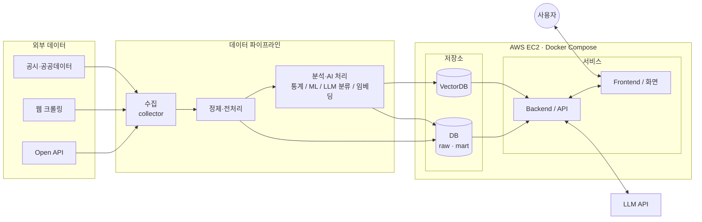
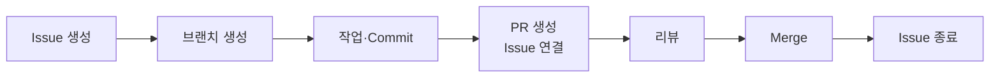

# 종합프로젝트 — 데이터 흐름 기반 의사결정 지원 서비스 구축 및 배포

| 항목 | 내용 |
|---|---|
| 기간 | 2026.11.24(화) ~ 2027.01.07(목) |
| 기획안 발표 | 2026.12.01(화) |
| 프로젝트 경진대회(발표) | 2027.01.08(금) |
| 구성 | 팀 프로젝트, 팀당 최대 4명 (자율 편성) |
| 핵심 기술 | Python·Pandas·SQL · API·웹 수집 · EDA·통계 · AI 활용 분석 · 생성형 AI·RAG · 시각화 · Docker · Git/GitHub |
| 최종 산출물 | AWS EC2 배포 서비스(URL), GitHub 저장소, 포트폴리오·기술문서, 시연 |

---

## 1. 과제 개요

### 1-1. 목표

- 외부 데이터의 **수집 → 처리·분석 → 저장 → 서비스 제공** 흐름을 하나의 시스템으로 구축
- 구축한 시스템을 **AWS EC2에 배포**하여 외부에서 접속 가능한 서비스로 제공
- GitHub **Issue 기반 작업 관리**와 **Branch·PR 기반 협업**으로 프로젝트 수행

### 1-2. 핵심 질문

> **"누가, 어떤 판단을 내릴 때, 이 서비스가 무엇을 근거로 어떻게 돕는가."**

### 1-3. 평가 초점

| 관점 | 내용 |
|---|---|
| 유용성 | 구체적인 사용자와 판단 상황 정의, 서비스의 실질적 도움 여부 |
| 사용성(UX) | 사용자의 실제 사용 맥락을 고려한 화면·사용 흐름 설계 |
| 완성도 | 데이터 한계, 예외 상황, 사용 흐름 등 세부 요소에 대한 고려 |
| 기술 이해도 | 기술·구조 선택 근거 설명 가능 여부, 팀원 전원의 전체 흐름 이해 |

---

## 2. 팀 구성 및 주제

### 2-1. 팀 구성

- 자율 편성, 팀당 최대 4명

### 2-2. 주제 선정 조건

- 주제 자율. 도메인 제한 없음
- 의사결정 지원 범주 외 주제 허용. 단, 사용자에게 실질적 도움이 되는 근거 제시 필요

| 조건 | 기준 |
|---|---|
| 구체적인 사용자 | 직무·상황이 특정된 사용자 ("기업", "일반인" 등 포괄적 정의 불가) |
| 구체적인 판단 | 사용자가 내려야 하는 결정을 한 문장으로 정의 |
| 사용 맥락(UX) | 사용 시점, 업무 상황, 사용 빈도 정의. 기존 업무 방식 대비 개선점 명시 |
| 데이터 흐름 | 외부 데이터를 수집·처리하여 판단 근거로 변환하는 과정 포함 |
| 데이터 확보 가능성 | 기획안 발표(12/1) 전 실제 데이터 확보 가능 여부 확인 |

### 2-3. 주제 예시

| 분야 | 예시 |
|---|---|
| 반도체 | 글로벌 뉴스·공시 시계열 기반 공급망 충격 탐지 및 기술 이슈 RAG 분석 플랫폼 |
| 제조 | 사고·품질 시계열 데이터 기반 이상 징후 탐지 및 예방 인사이트 AI |
| 공공 | 텍스트 마이닝을 활용한 ESG 모니터링 시스템 구축 |

※ 예시 주제는 변형하여 활용

---

## 3. 요구사항

### 3-1. 필수 요구사항

| 구분 | 요구사항 |
|---|---|
| 기획·UX | 사용자·판단·핵심 질문 정의, 기존 방식 대비 차별점 정리 |
| | 사용 맥락 및 사용 시나리오 정의 |
| | 핵심 요구사항 목록(ID 부여), User Flow, 주요 화면 구성안 작성 |
| 데이터 파이프라인 | 외부 데이터(Open API·크롤링·공시·공공데이터 등) 수집 코드의 재실행 가능 구조 |
| | 원본(raw)·가공(mart) 데이터 분리 저장 |
| | 수집 → 정제 → 분석·AI 처리 → 저장의 순차 재실행 가능 구조 |
| 분석·AI | 판단 근거가 되는 지표·분석 결과 생성 (EDA·통계·ML·DL·LLM 중 주제에 맞는 기술) |
| | AI·모델 결과의 적절성 검증(표본 검수, 평가셋, 평가지표) 및 기록 |
| | 근거 문서 기반 기능의 출처 표시, 근거 부재 시 답변 거절 (RAG 적용 시) |
| 서비스 | 사용자 입력 → 처리 → 결과 출력 흐름의 단일 서비스 동작 |
| | 정상·오류·예외 상황 사전 정의 및 대응 확인 |
| 배포 | **Docker 기반 실행 환경 구성** (Dockerfile, docker compose) |
| | AWS EC2 배포, 외부 URL 접속 및 무설치 이용 가능 |
| 협업 | Issue 기반 작업 관리, Branch → PR → Merge 흐름으로 반영 |
| | `README.md`에 저장소 구조, 실행 방법, 서비스 URL 기술 |
| 검증 | 사용자 테스트 수행, 피드백 수집 및 반영 |

### 3-2. 심화 확장 (선택)

| 항목 | 내용 |
|---|---|
| 수집 자동화 | 스케줄러(cron 등) 기반 주기적 수집·갱신 |
| CI | PR 시 테스트·린트 자동 실행 (GitHub Actions) |
| FE·BE 분리 | API 서버(FastAPI 등)와 프론트엔드 분리 구성 |
| 모니터링 | 수집 실패·API 오류 로그 및 알림 |
| AI Agent | 다중 도구(검색·DB 조회·계산) 조합 Agent 구성 |

※ 필수 요구사항 완료 후 진행

---

## 4. 시스템 설계

### 4-1. 시스템 아키텍처



**설계 원칙**

| 원칙 | 내용 |
|---|---|
| 사전 처리 | 외부 데이터 수집, 대량 LLM 분류, 임베딩 생성은 파이프라인에서 사전 수행 후 저장 |
| 조회 중심 서비스 | 서비스는 저장된 결과 조회. 실시간 호출은 사용자 질의 응답 등 필수 기능으로 한정 |
| 계층 독립성 | 계층별 독립 실행 가능. 수집 실패 시에도 서비스는 최종 저장 데이터로 동작 |

### 4-2. 서비스 구성 방식

| 방식 | 구성 | 적합한 경우 |
|---|---|---|
| A. Streamlit 단일 앱 | Streamlit + DB + (VectorDB) | 대시보드·Q&A 중심 서비스 |
| B. FE·BE 분리 | FE(Streamlit 또는 웹 프론트) + BE(FastAPI 등) + DB | 다중 화면, 외부 연동, API 재사용 필요 시 |

- 방식 선택 이유를 기술문서에 기록
- A 방식 선택 시에도 수집·처리 코드와 화면 코드는 디렉터리 단위로 분리

### 4-3. 저장소 구성

| 방식 | 구성 | 장점 | 유의점 |
|---|---|---|---|
| 모노레포 | 단일 저장소, `pipeline/`·`backend/`·`frontend/` 디렉터리 분리 | Issue·PR 단일 관리, 공통 스키마 공유 용이 | 디렉터리별 담당 명확화로 충돌 방지 |
| 멀티레포 | FE·BE(·pipeline) 저장소 분리, GitHub Organization 사용 | 배포 단위와 저장소 일치 | 저장소 간 API 명세 문서화, 저장소별 Issue 관리 |

**모노레포 구성 예시**

```
project/
├── README.md               # 서비스 개요, 아키텍처, 실행·배포 방법, 서비스 URL
├── .env.example            # 환경변수 목록 (값 제외)
├── docker-compose.yml      # 서비스 구성요소 정의
├── docs/
│   ├── requirements.md     # 요구사항 목록 (ID·우선순위·구현 여부)
│   ├── architecture.md     # 아키텍처, 기술 선택 근거
│   ├── schema.sql          # DB 스키마
│   └── test_cases.md       # 정상·오류·예외 상황 및 대응 결과
├── pipeline/               # 수집·정제·분석·임베딩
│   ├── collect/
│   ├── process/
│   └── run_all.py
├── backend/                # (B 방식) API 서버, Dockerfile
├── frontend/ 또는 app/     # 화면, Dockerfile
└── tests/
```

### 4-4. DB 설계

- 원본 테이블(`raw_*`)과 서비스 조회용 테이블(`mart_*`) 분리
- 수집 시점(`collected_at`), 출처(`source`) 컬럼 포함
- 재수집 시 중복 적재 방지 키 설계 (`UNIQUE`, upsert)
- DB·VectorDB 데이터의 EC2 이전 방식(파이프라인 재실행 또는 파일·볼륨 이전) 사전 결정

---

## 5. 협업 및 형상관리 (GitHub)

### 5-1. 작업 흐름



### 5-2. Issue

- 모든 작업(기능 개발, 데이터 조사, 버그, 의사결정)의 Issue 등록
- 본문 구성: **목적 / 작업 내용 / 완료 조건**
- 라벨 예시: `feature` `data` `bug` `docs` `decision`
- 진행 상태는 담당자·라벨·열림/닫힘 상태로 관리
- 진행 중 판단 변경 시 Issue 댓글로 변경 사유 기록

### 5-3. Branch · PR

| 항목 | 규칙 |
|---|---|
| `main` | 직접 push 금지, 실행 가능 상태 유지 |
| 브랜치명 | Issue 번호 포함 (예: `feat/12-dart-collector`, `fix/18-chart-filter`) |
| PR 본문 | 변경 내용 / 확인 방법 / 연결 Issue(`Closes #12`) |
| PR 단위 | PR 1건당 단일 목적 |
| 리뷰 | 선택 사항 |

### 5-4. Commit

- 작업 단위 커밋
- 메시지 형식: `type: 변경 내용` (예: `feat: DART 공시 목록 수집 기능 추가`, `fix: 기간 필터 미반영 오류 수정`)
- "최종", "수정" 등 의미 없는 메시지 사용 금지

### 5-5. 보안 및 데이터 윤리 (공통 적용 기준)

- API 키·DB 접속 정보: `.env` 관리, `.gitignore` 등록, 저장소 업로드 금지
- 키 커밋 이력 발생 시 즉시 재발급
- 개인정보의 불필요한 수집·외부 전송·노출 금지. LLM API 전송 전 개인정보 처리 방식 결정
- 크롤링·API 이용 약관 및 호출 제한 준수

---

## 6. 배포 (Docker · AWS EC2)

### 6-1. 배포 일정

| 시점 | 내용 |
|---|---|
| ~ 5주차 | 로컬 Docker 환경 구성 완료. `docker compose up`으로 전체 서비스 실행 가능 상태 |
| 6주차 (12/28 주) | AWS EC2 인스턴스 제공, EC2 배포 |
| 7주차 | 배포 환경 안정화, 경진대회 전일까지 URL 정상 동작 확인 |

### 6-2. EC2 제공 전 준비 사항

- [ ] 구성요소별 Dockerfile 및 `docker-compose.yml` 작성
- [ ] 로컬에서 `docker compose up`으로 전체 서비스 실행 확인
- [ ] 환경변수 목록 `.env.example` 정리
- [ ] 파이프라인·서비스 실행 순서 `README.md`에 명령어 단위로 기술
- [ ] 서비스의 외부 접속 허용 설정 (`0.0.0.0` 바인딩, 포트 매핑)
- [ ] 저장소 신규 clone 후 README 기준 실행 리허설 1회 이상

### 6-3. 배포 요건

| 요건 | 기준 |
|---|---|
| URL 접속 | 외부 네트워크에서 제출 URL 접속 가능 |
| 무설치 이용 | 별도 환경 구성 없이 이용 가능 |
| 구성요소 구동 | 화면·API·DB·VectorDB 등 주요 요소의 EC2 구동 |
| 외부 연계 | LLM API·DB 등 외부 연결의 EC2 정상 동작 |
| 재접속 | 새로고침·재접속 후 정상 이용 가능 |

### 6-4. 유의사항

- 보안 그룹 인바운드 규칙에 서비스 포트 개방
- 컨테이너 재시작 정책 설정 (`restart: unless-stopped` 등). SSH 종료 후에도 서비스 유지
- DB·VectorDB 데이터는 Docker 볼륨으로 영속화
- 인스턴스 사양(메모리·디스크) 대비 데이터·벡터 인덱스 크기 확인. 임베딩 등 고부하 작업은 사전 수행 후 결과 이전
- LLM API 호출 제한 설정 (요청 수, 입력 길이)

---

## 7. 동작 안정성

- 대표 정상·오류·예외 상황 사전 정의 및 대응 확인 (`docs/test_cases.md`)
- 오류 발생 시 서비스 비정상 종료 방지, 오류 메시지 출력, 처리 후 기능 재실행 가능 구조

**테스트 항목 정의 예시**

| ID | 구분 | 입력·실행 조건 | 기대 결과 | 확인 |
|---|---|---|---|---|
| T-01 | 정상 | 기간·대상 선택 후 조회 | 해당 조건의 지표·차트 출력 | |
| T-02 | 오류 | 빈 값·잘못된 형식 입력 | 안내 메시지 출력, 서비스 유지 | |
| T-03 | 오류 | 외부 API(LLM 등) 응답 실패 | 오류 메시지 출력, 타 기능 정상 이용 | |
| T-04 | 예외 | 근거 문서 부재 질문 | 답변 거절 메시지 출력 | |
| T-05 | 예외 | 조회 결과 0건 조건 | "데이터 없음" 안내, 화면 정상 표시 | |

---

## 8. 사용자 경험(UX) 설계 및 검증

### 8-1. UX 설계 기준

| 관점 | 확인 항목 |
|---|---|
| 진입 | 첫 화면에서 수행할 작업의 즉시 인지 가능 여부 |
| 핵심 동선 | 판단에 필요한 정보까지의 도달 단계 수 |
| 정보 우선순위 | 결론·핵심 지표 우선 노출, 근거·상세 정보의 선택적 확인 구조 |
| 용어 | 개발·분석 용어가 아닌 사용자 업무 용어 사용 |
| 신뢰 | 결과 근거(출처, 기준 시점, 데이터 범위) 확인 가능 여부 |
| 상태 안내 | 로딩, 결과 없음, 오류 상황의 안내 제공 |
| 업무 연결 | 결과의 후속 업무(보고서·회의 등) 활용 용이성 (요약, 다운로드 등) |

- User Flow 및 주요 화면 구성안(와이어프레임 수준) 작성
- 화면 설계 의도 기술문서 기록

### 8-2. 사용자 검증

| 항목 | 내용 |
|---|---|
| 대상 | 실제 직무 종사자 우선. 불가 시 사용자 역할·판단 상황을 부여한 테스터 |
| 방법 | 판단 시나리오 제시 후 사전 설명 없이 사용, 관찰·인터뷰·설문 |
| 기록 | 참여 인원, 시나리오, 소요 시간, 만족도, 이탈·불편 지점, 반영 여부 |
| 반영 | 피드백 1건 이상 Issue 등록 및 PR 반영. 미반영 항목은 후속 고도화 방안으로 정리 |

---

## 9. 진행 일정

### 9-1. 주차별 일정

| 주차 | 기간 | 단계 | 주요 수행 내용 | 완료 기준 |
|---|---|---|---|---|
| 1주 | 11/24(화) ~ 11/27(금) | 기획 | 팀·주제 확정, 사용자·판단·사용 맥락 정의, 데이터 확보 가능성 확인, 저장소·Issue 체계 구축, 기획안 작성 | 기획안 작성 완료 |
| 2주 | 11/30(월) ~ 12/4(금) | **기획안 발표**·설계 | **12/1 기획안 발표**, 피드백 반영, 요구사항 목록·User Flow·화면 구성안·아키텍처·스키마 확정, 수집 착수 | 요구사항·스키마 확정 |
| 3주 | 12/7(월) ~ 12/11(금) | 파이프라인 | 수집·정제·적재 완성, EDA, 분석·AI 기능 착수 | DB 적재 완료, 파이프라인 재실행 가능 |
| 4주 | 12/14(월) ~ 12/18(금) | 분석·AI 기능 | 지표 산출, ML·LLM·RAG 기능 구현 및 검증, 화면 개발 착수 | 핵심 기능별 결과 및 검증 기록 확보 |
| 5주 | 12/21(월) ~ 12/24(목) | 서비스 통합 | 화면·기능 연계, 오류·예외 처리, Docker 구성, 사용자 테스트 1차 | 로컬 Docker 환경에서 전체 흐름 동작 |
| 6주 | 12/28(월) ~ 12/31(목) | EC2 배포 | EC2 배포, 배포 환경 검증, 사용자 피드백 반영 | 제출 URL로 전체 흐름 동작 |
| 7주 | 1/4(월) ~ 1/7(목) | 안정화·발표 준비 | 오류 수정, 기술문서·발표자료 작성, 시연 리허설 | 제출물 완성 |
| — | 1/8(금) | 프로젝트 경진대회 | 발표 및 시연 | — |

### 9-2. 기획안 발표 (12/1)

| 항목 | 내용 |
|---|---|
| 주제 | 서비스명, 한 줄 소개 |
| 사용자·판단 | 대상 사용자, 판단 상황, 사용 맥락, 기존 방식의 문제점 |
| 데이터 | 데이터 출처, 확보 방식, 확보 가능 여부 확인 결과 |
| 핵심 기능 | 핵심 요구사항 목록, 주요 User Flow |
| 시스템 | 아키텍처 초안, 적용 예정 핵심기술 |
| 수행 계획 | 역할 분담, 주차별 일정 |

### 9-3. 멘토링

| 멘토 | 일정 |
|---|---|
| 신재웅 | 11/27(금) 8시간 · 12/18(금) 8시간 · 12/31(목) 4시간 |
| 이연지 | 12/1(화) 8시간 · 12/8(화) 4시간 · 12/14(월) 4시간 |
| 김두현 | 12/28(월) 8시간 |

| 주차 | 멘토링 일정 |
|---|---|
| 1주 | 11/27 신재웅 (8h) |
| 2주 | 12/1 이연지 (8h) |
| 3주 | 12/8 이연지 (4h) |
| 4주 | 12/14 이연지 (4h) · 12/18 신재웅 (8h) |
| 6주 | 12/28 김두현 (8h) · 12/31 신재웅 (4h) |

- 멘토링 전 질문·검토 요청 사항을 Issue 또는 문서로 사전 정리
- 멘토링 결과 및 반영 사항을 Issue로 기록

---

## 10. 개발 환경 및 장비

| 항목 | 내용 |
|---|---|
| 배포 서버 | AWS EC2 (6주차 제공 예정) |
| GPU 서버 | Colab용 GPU 서버 (세부 내용 추후 안내) |
| LLM API | 기존에 제공된 것 활용 (GPT, Gemini) |

---

## 11. 역할 분담 (예시)

| 역할 | 주요 담당 |
|---|---|
| 데이터 파이프라인 | 수집·정제·적재, 스키마, 수집 재실행 구조 |
| 분석·AI | 지표 산출, ML·LLM·RAG 기능, 결과 검증 |
| 서비스·배포 | 화면·API, 기능 연계, Docker·EC2 배포, 오류 처리 |
| 기획·PM (겸임) | 요구사항·Issue·일정 관리, UX 설계·사용자 검증, 기술문서 총괄 |

- 팀원별 담당 영역의 코드 및 PR 이력 필요. 문서 작업 단독 전담 지양
- 팀원 전원의 전 과정 설계 판단 설명 가능 상태 유지
- 2주차 내 스키마 및 계층 간 인터페이스(테이블 구조, API 명세) 합의

---

## 12. 제출물

| 제출물 | 내용 |
|---|---|
| 서비스 URL | EC2 배포 서비스. 심사 기간 중 접속 가능 상태 유지 |
| GitHub 저장소 URL | Issue·PR·Commit 이력 포함. `README.md`에 서비스 URL·실행 방법 기술 |
| 포트폴리오·기술문서 | 발표자료 겸용. 12-1 구성 참고 |
| 시연 | 경진대회 현장 데모. 사용자 입력 → 결과 출력, 복수 기능 연계, 오류 처리 포함 |

### 12-1. 포트폴리오·기술문서 구성

**작성 원칙**
- 두괄식 구성: 결과물(서비스)을 먼저 제시하고, 이후 기술적 해결 과정 기술
- 포트폴리오 및 기술 면접 자료로 활용 가능한 수준의 구체성 확보
- 각 항목은 "무엇을 → 왜 → 어떻게 → 결과" 순으로 기술

| 순서 | 구성 | 내용 |
|---|---|---|
| 1 | 서비스 소개 및 시연 | 서비스명, 한 줄 소개, 서비스 URL, 주요 화면, 핵심 기능 시연 (사용 시나리오 기반) |
| 2 | 해결한 문제 | 대상 사용자, 판단 상황, 기존 방식의 한계, 서비스 도입 후 변화 |
| 3 | 시스템 아키텍처 | 아키텍처 다이어그램, 데이터 흐름, 구성요소 간 연결 관계, 배포 구성 |
| 4 | 기술 스택 및 선택 근거 | 기술별 모델·도구·버전, 적용 기능, 선택 이유, 대안 비교 |
| 5 | 핵심 기능 구현 | 기능별 구현 방식, 데이터 처리 로직, AI 적용 방식, 결과 검증 지표 |
| 6 | 트러블슈팅 | 프로젝트 중 발생한 주요 이슈별 **문제 상황 → 원인 분석 → 해결 방법 → 결과** (관련 Issue·PR 링크) |
| 7 | 기술적 고려 사항 | 성능·안정성·보안·UX 측면에서 중점적으로 설계·구현한 부분과 그 이유 |
| 8 | 검증 및 성과 | 사용자 테스트 결과, AI·모델 성능 지표, 오류·예외 처리 확인 결과 |
| 9 | 협업 및 형상관리 | 저장소 구조, Issue·PR 운영 방식, 역할 분담 |
| 10 | 한계 및 고도화 방안 | 현재 한계, 사용자 피드백 기반 개선 방향, 실제 도입 시 필요 사항 |

**기술 스택 표 작성 예시**

| 핵심 기술 | 모델·도구·버전 | 적용 기능 | 선택 근거 | 성능 결과 |
|---|---|---|---|---|
| RAG | LangChain x.x, Chroma x.x, text-embedding-3-small | 공시 근거 Q&A | 원문 근거 제시, 환각 억제 | 평가셋 30문항 중 근거 일치 83% |
| LLM 분류 | GPT-4o-mini | 뉴스 이슈 유형 분류 | 대량 기사 정량화 | 표본 100건 정답률 86% |

**트러블슈팅 작성 예시**

| 항목 | 내용 |
|---|---|
| 문제 상황 | 동일 기사 재배포본으로 RAG 검색 상위 결과 중복 |
| 원인 분석 | 키워드 기반 수집으로 매체별 재배포본 다수 포함 |
| 해결 방법 | 제목·본문 유사도 기반 중복 제거 후 대표 문서만 임베딩 |
| 결과 | 상위 5건 중 고유 문서 비율 40% → 100%, 근거 일치율 개선 (Issue #23, PR #27) |

- 성능 목표는 기획 단계에서 설정, 최종 결과와 비교하여 달성 여부 기록. 미달 항목은 원인과 개선 방향 기술

---

## 13. 평가

### 13-1. 평가 구성

| 영역 | 평가 대상 | 평가 방식 |
|---|---|---|
| 포트폴리오·기술문서 | 발표자료·기술문서, GitHub 저장소 | 문서 및 저장소 기재 내용 기준 |
| 최종 구현 산출물 | 시연, 서비스 URL | 시연 및 URL 직접 접속 확인 |

- 평가자: 주강사, 멘토, 외부 심사위원

### 13-2. 평가 항목

| 영역 | 평가 항목 |
|---|---|
| 포트폴리오·기술문서 | 산출물 정리 및 문서화 수준 |
| | 설계·기술 선택 근거 |
| | 코드 품질 및 형상관리 (Issue·PR·Commit 이력) |
| | 결과물의 실용성·활용 가능성 (사용자 검증 포함) |
| 최종 구현 산출물 | 핵심 기술요소의 통합 구현도 |
| | 기능 구현 완성도 |
| | 동작 안정성 (오류·예외 처리) |
| | 실행 환경 구성 및 배포 수준 |

### 13-3. 핵심기술 체크리스트

- 주제에 맞는 기술 선택 적용. 서비스 내 실제 동작 기준으로 평가

| No | 핵심 기술 | 확인 기준 |
|---|---|---|
| 1 | Python 프로그래밍 기초 | Python 기본 문법(변수·자료형·조건문·반복문·함수·클래스)으로 코드를 작성하고, CSV·Excel 파일을 읽어 원하는 값을 계산할 수 있다 |
| 2 | Pandas·NumPy 기반 데이터 처리 | Pandas로 데이터를 불러와 필터링·그룹별 집계·병합 등 가공을 하고, NumPy로 기본 수치 연산을 수행할 수 있다 |
| 3 | SQL 기반 데이터 조회 및 분석 | SELECT·WHERE·JOIN·GROUP BY로 필요한 데이터를 조회·집계하고, 같은 KPI를 Python과 SQL로 각각 계산해 결과를 비교할 수 있다 |
| 4 | API·웹 기반 데이터 수집 및 정제·저장 | API 문서를 활용하거나 HTTP 요청·응답과 HTML 구조를 이해하여 필요한 데이터를 수집하고, 이용 조건·호출 제한을 준수하며 중복·결측·형식 오류를 정제해 파일 또는 DB에 저장할 수 있다 |
| 5 | 데이터 시각화·대시보드 구현 및 결과 전달 | 분석 목적에 맞는 인터랙티브 차트와 필터가 있는 대시보드를 구현하고, 보고 대상에 맞춰 핵심 메시지와 근거·시사점을 설명할 수 있다 |
| 6 | EDA 및 통계 분석 | 결측치·이상치를 처리하고 기술통계·분포·상관관계를 분석하며, 가설검정(A/B 테스트 등)을 수행해 p-value를 해석할 수 있다 |
| 7 | AI 활용 데이터 분석 | 분석 목적과 데이터 특성에 맞는 AI 모델 또는 서비스를 활용해 예측·분류·감정 분석·정보 추출 등을 수행하고, 결과를 해석하며 적절성을 검증할 수 있다 |
| 8 | 생성형 AI 활용 데이터 분석 시스템 설계·구축 | 생성형 AI를 활용해 요구사항에 맞는 시스템 아키텍처와 데이터 흐름을 설계하고, 수집·저장·분석·대시보드를 연계한 시스템을 구축하며 생성된 코드의 오류를 검증·수정할 수 있다 |
| 9 | RAG 기반 문서 데이터 분석 | 문서를 임베딩해 벡터DB에 저장하고, 관련 문서를 검색하여 접근이 허용된 자료를 바탕으로 출처를 명시한 답변을 생성하는 Q&A 챗봇을 구현할 수 있다 |
| 10 | Git/GitHub 기반 협업 및 프로젝트 관리 | GitHub에 분석 코드를 커밋·푸시하고, 브랜치와 PR로 팀원과 협업하며 Issue로 할 일을 관리할 수 있다 |
| 11 | 데이터 분석 프로젝트 수행 | 분석 목표와 질문을 정의하고 수집→정제→분석→시각화→보고의 전 과정을 팀 내 역할 분담과 일정 관리 하에 수행할 수 있다 |

> **공통 적용 기준:** 개인정보의 불필요한 수집·외부 전송·노출 방지, API 키 등 인증정보의 안전한 관리. 관련 항목 구현 결과에서 준수 여부 확인 (5-5 참고)

---

## 14. 제출 전 점검 목록

**기획·문서**
- [ ] 사용자·판단·핵심 질문 정의
- [ ] 사용 맥락, 사용 시나리오, User Flow, 화면 설계 의도 정리
- [ ] 요구사항 목록(ID·구현 여부) 작성
- [ ] 아키텍처 다이어그램 작성
- [ ] 기술별 도구·버전·선택 근거·성능 결과 정리
- [ ] 트러블슈팅 사례 정리 (관련 Issue·PR 연결)
- [ ] 핵심기술 체크리스트별 적용 위치 기술

**파이프라인·서비스**
- [ ] 수집·처리 코드 재실행 가능, 재실행 시 중복 적재 없음
- [ ] 서비스의 저장 결과 조회 구조, 대량 처리의 실시간 수행 없음
- [ ] AI·모델 결과 검증 및 기록
- [ ] 근거 기반 답변의 출처 표시

**배포·안정성**
- [ ] Dockerfile·`docker-compose.yml` 기반 실행 환경 구성
- [ ] 제출 URL(EC2) 외부 접속, 새로고침·재접속 후 정상 동작
- [ ] SSH 종료 후 서비스 유지, 데이터 볼륨 영속화
- [ ] EC2 환경에서 DB·LLM API 등 외부 연계 정상 동작
- [ ] 대표 오류·예외 상황 정의 및 대응 확인
- [ ] 오류 발생 후 서비스 지속 이용 가능

**협업·형상관리**
- [ ] Issue 기반 작업 관리, PR과 Issue 연결
- [ ] `main` 직접 push 없이 PR로 반영
- [ ] API 키의 저장소·발표자료·서비스 화면 노출 없음

**검증·발표**
- [ ] 사용자 테스트 수행, 결과 및 반영 내역 기록
- [ ] 시연 시나리오에 정상 흐름 및 오류 처리 포함
- [ ] 팀원 전원 전 과정 설계 판단 설명 가능
