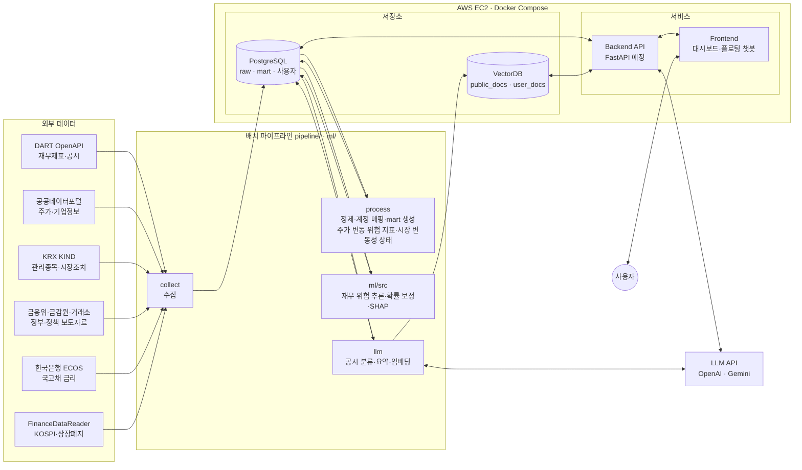
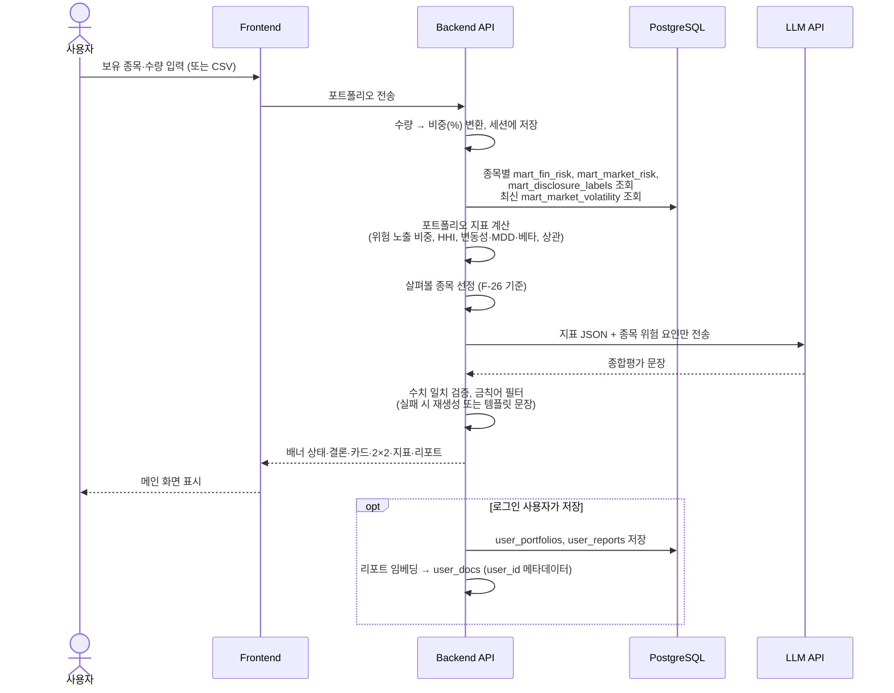
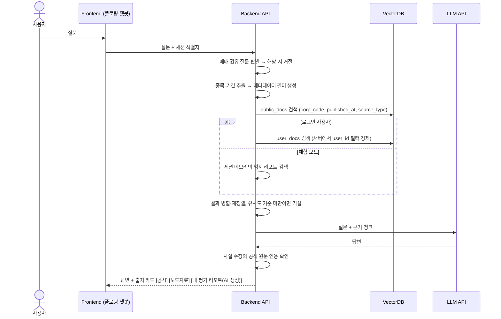
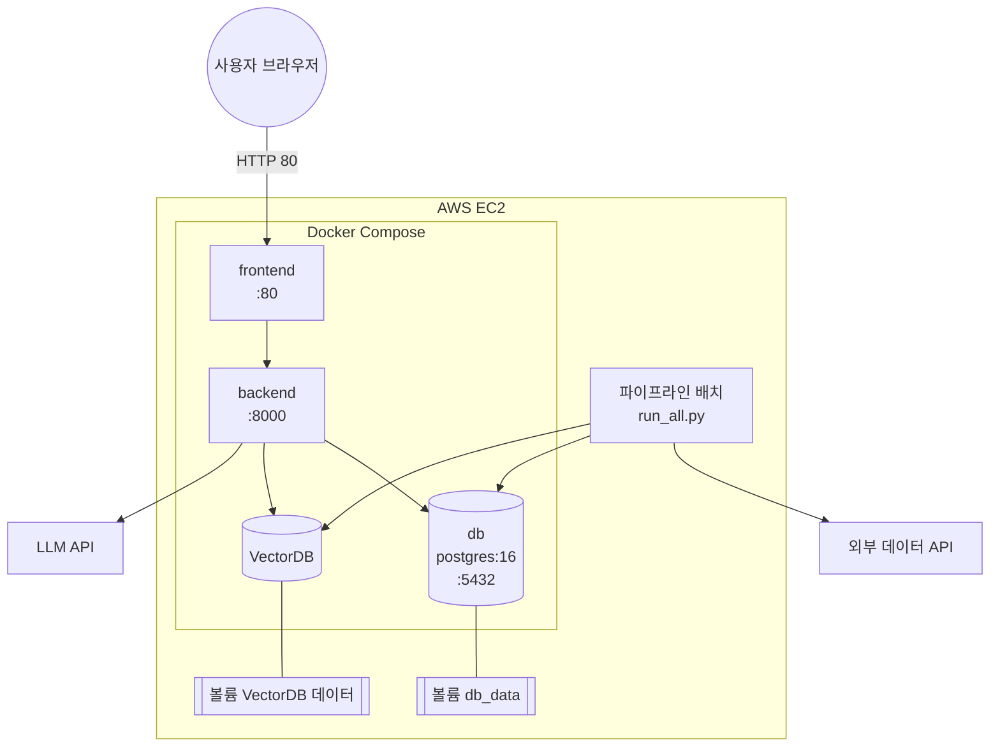

# 시스템 아키텍처

- 근거 문서: `docs/guide/기획안_보유종목_위험점검_v3.md`, `docs/guide/종합프로젝트_가이드_데이터기반_의사결정지원_서비스.md`, `docs/repo_structure.md`, `docker-compose.yml`
- 기획안 v3가 팀 논의용 초안이므로 이 문서도 초안. 미확정 항목은 8장에 별도 정리

## 1. 설계 원칙

| 원칙 | 내용 |
|---|---|
| 사전 처리 | 외부 데이터 수집, 재무 위험 모델 추론, 주가 변동 위험 계산, 공시 LLM 분류·요약, 임베딩은 배치 파이프라인에서 미리 수행 후 DB·VectorDB에 저장 |
| 조회 중심 서비스 | 서비스는 저장된 결과를 조회. 실시간 LLM 호출은 종합평가 리포트 생성과 챗봇 답변으로 한정 |
| 계층 독립성 | 수집·처리·서비스 계층을 독립 실행. 수집이 실패해도 서비스는 마지막으로 적재된 데이터로 동작 |
| 재실행 안전성 | 파이프라인 각 단계는 upsert로 적재해 재실행 시 중복 적재 없음 (`pipeline/run_all.py`) |
| 두 축 분리 | 재무 위험(ML)과 주가 변동 위험(계산 지표)을 별도 테이블·별도 등급으로 관리하고 합산 점수를 만들지 않음 |
| 개인 데이터 최소화 | 체험 모드 데이터는 세션에만 보관. 로그인 사용자만 DB 저장. 외부 LLM에는 비중(%)과 위험 요인만 전송 |

## 2. 전체 구성도

- 파이프라인은 상시 실행 컨테이너가 아닌 배치 작업. 실행 위치는 8장 참고

## 3. 구성요소

| 구성요소 | 디렉터리 | 역할 | 입력 | 출력 |
|---|---|---|---|---|
| 수집 | `pipeline/collect/` | 외부 API 호출, 크롤링, 원본 적재 | 외부 데이터 | `raw_*` 테이블 |
| 정제·지표 | `pipeline/process/` | 계정과목 표준화, 업종 평균, 기업-시점별 변수 생성, 주가 변동 위험 지표·등급 계산, 시장 변동성 배너 상태 계산 | `raw_*` | `mart_features`, `mart_market_risk`, `mart_market_volatility` |
| 재무 위험 모델 | `ml/src/` | 연 1회 학습, 주 1회 추론, 확률 보정, 등급 변환, 규칙 덮어쓰기, SHAP 요인 추출 | `mart_features`, 시장조치 | `mart_fin_risk`, `ml/models/` |
| LLM 처리 | `pipeline/llm/` | 공시 위험 유형 분류·3줄 요약, 공시·보도자료 청킹·임베딩 | `raw_disclosures`, `raw_press_releases` | `mart_disclosure_labels`, `public_docs` |
| 파이프라인 실행 | `pipeline/run_all.py` | 위 단계 순차 실행 | - | - |
| Backend API | `backend/` | 포트폴리오 입력, 지표 조회, 포트폴리오 지표 계산, 종합평가 리포트 생성·검증, RAG 챗봇, 세션·계정 관리 | DB, VectorDB, LLM API | JSON 응답 |
| Frontend | `frontend/` | 메인(시장 변동성 배너·한 줄 결론·살펴볼 종목·2×2 위험 지도), 종목 상세, 플로팅 챗봇, 로그인 | Backend API | 화면 |
| 공통 | `shared/` | 공통 스키마, 설정, 용어 사전 | - | - |
| DB | `docker-compose.yml`의 `db` | PostgreSQL 16, Docker 볼륨 `db_data`로 영속화 | - | - |

## 4. 데이터 흐름

### 4-1. 배치 파이프라인

| 순서 | 단계 (`run_all.py` 기준) | 주기 | 처리 내용 |
|---|---|---|---|
| 1 | `collect_dart` | 일 (재무제표는 분기) | 재무제표, 공시 목록·원문 수집 |
| 2 | `collect_kind` | 일 | 관리종목·상장폐지 사유, 시장조치, 거래정지 이력 수집 |
| 3 | `collect_prices` | 일 | 일별 주가·시가총액, KOSPI 지수 수집 |
| 4 | `collect_press` | 일 | 금융위원회(금융위원회 홈페이지), 재정경제부·공정거래위원회(정책브리핑), 금융감독원(보도자료 API, 소비자경보는 홈페이지), 한국거래소(홈페이지) 보도자료 수집 |
| 5 | `build_mart_features` | 주 | 재무비율, 업종 평균(t 시점까지 공시된 기업만), 상장 규정 근접도, 공시 이벤트 변수, Merton 부도거리 |
| 6 | `price_risk` | 주 | 변동성(120거래일 일별 수익률 표준편차), 하락 변동성, MDD, 베타, 거래대금, 시장조치 반영 → 5단계 등급 |
| 7 | `market_volatility` | 주 (토요일 결산) | 그 주 마지막 거래일 기준 KOSPI 20거래일 변동성 계산, 주의(과거 10년 상위 10%)·경고(5.0%)·해제(상위 20%) 판정, 직전 결산 주 상태 기록 → `mart_market_volatility` |
| 8 | `score_financial_risk` | 주 (학습은 연 1회) | 보정 확률 → 4단계 등급, 규칙 덮어쓰기, 여유 구간 적용, 모델 버전 기록 |
| 9 | `classify_disclosures` | 일 | 위험 유형 분류·요약 (LLM) |
| 10 | `embed_documents` | 일 | 위험 유형 공시·보도자료 청크 임베딩 → `public_docs` |

- 모든 변수는 공시일 기준으로 정렬해 t 시점 이전 정보만 사용 (라벨 누수 방지)
- 수집 단계별 실패 로그를 남기고, 실패한 단계 이후의 mart는 직전 값 유지

### 4-2. 포트폴리오 평가 요청

- LLM 호출이 실패해도 지표·차트는 정상 표시하고 리포트 영역에만 재시도 안내 (T-03)

### 4-3. RAG 챗봇 질의

- 챗봇 답변은 다시 RAG 자료로 저장하지 않음 (순환 오염 방지)
- 사용자별 일일 요청 수 제한 (`LLM_DAILY_REQUEST_LIMIT`)

## 5. 저장 구조

| 계층 | 저장 위치 | 대상 |
|---|---|---|
| raw | PostgreSQL | `raw_financials`, `raw_disclosures`, `raw_prices`, `raw_delisting`, `raw_press_releases`. 모두 `source`, `collected_at` 컬럼과 UNIQUE 키 |
| mart | PostgreSQL | `mart_features`, `mart_fin_risk`, `mart_market_risk`, `mart_market_volatility`, `mart_disclosure_labels` |
| 사용자 | PostgreSQL | `users`(닉네임, 비밀번호 해시), `user_portfolios`(종목·비중), `user_reports`(지표 JSON, 본문, 검증 결과). 로그인 사용자만 |
| 공용 문서 | VectorDB `public_docs` | 공시·보도자료 청크. 메타데이터 `source_type`, `corp_code`, `published_at`, `title`, `url` |
| 개인 문서 | VectorDB `user_docs` | 로그인 사용자 리포트 청크. 메타데이터 `user_id`, `generated_by` 필수 |
| 체험 모드 | 서버 세션 메모리 | 포트폴리오, 리포트, 챗봇 대화. 세션 종료·만료 시 삭제 |
| 모델 | `ml/models/` (git 미포함) | 학습된 재무 위험 모델, 보정기. 버전은 `mart_fin_risk`에 기록 |

- 상세 컬럼 정의는 `docs/schema.sql`에서 관리

## 6. 보안·개인정보

| 항목 | 방식 |
|---|---|
| 계정 | 닉네임 + 비밀번호 해시. 이메일·실명·전화번호 미수집 |
| 세션 | `SESSION_SECRET_KEY`로 서명한 서버 세션 |
| 데이터 격리 | `user_docs`·사용자 테이블 조회 시 세션의 `user_id`를 서버에서 필터로 강제. 클라이언트가 보낸 `user_id`는 사용하지 않음 (T-07) |
| 외부 LLM 전송 범위 | 비중(%), 지표 JSON, 종목 위험 요인만. 수량·금액·닉네임 미전송 |
| 데이터 삭제 | 로그인 사용자 요청 시 DB 행과 `user_docs` 벡터를 함께 삭제 (T-10) |
| 비밀 값 | API 키·DB 계정은 `.env`에만 보관하고 커밋하지 않음 (`.env.example` 참고) |
| 투자 권유 차단 | 리포트 금칙어 필터, 챗봇 매매 권유 질문 거절, 화면 면책 문구 |

## 7. 배포 구성

| 항목 | 내용 |
|---|---|
| 실행 단위 | `docker compose up -d`로 frontend, backend, db(, VectorDB) 실행. 현재 `docker-compose.yml`은 db만 활성, backend·frontend는 주석 상태 |
| 재시작 정책 | 모든 서비스 `restart: unless-stopped`. SSH 종료 후에도 유지 |
| 영속화 | DB·VectorDB 데이터는 Docker 볼륨에 저장 |
| 외부 노출 | frontend 포트만 보안 그룹에서 개방. backend는 `0.0.0.0` 바인딩 후 frontend 경유 접근 권장, db 포트는 외부 미개방 |
| 환경변수 | 각 컨테이너는 `.env`를 `env_file`로 읽음 |
| 데이터 이전 | 임베딩 등 고부하 작업은 로컬·GPU 서버에서 사전 수행 후 결과를 EC2로 이전 |
| 일정 | 5주차 로컬 `docker compose up` 전체 동작, 6주차 EC2 배포 |

## 8. 미확정 사항

| 항목 | 현재 상태 | 영향 범위 |
|---|---|---|
| 서비스 구성 방식 | FastAPI + 프론트 분리 쪽으로 진행 중 (`docker-compose.yml`, `docs/repo_structure.md`). 플로팅 챗봇·세션 관리 구현 측면에서 분리 방식이 유리 | backend·frontend 구조, Dockerfile |
| 프론트엔드 기술 | 미정 | `frontend/` 구조, 플로팅 챗봇 구현 방식 |
| VectorDB 제품 | 미정. 후보: pgvector(기존 PostgreSQL 재사용, 컨테이너 추가 없음), Chroma(별도 컨테이너·볼륨) | 컨테이너 구성, 메타데이터 필터 방식 |
| 세션 저장소 | 미정. 서버 메모리는 backend 재시작 시 체험 데이터 소실 | 체험 모드 동작, 세션 만료 정책 |
| 파이프라인 실행 위치 | 미정. 후보: EC2 cron에서 `run_all.py` 실행, 로컬 실행 후 데이터 이전 | 데이터 자동 갱신(F-23), EC2 사양 |
| 임베딩 모델 | 미정 (OpenAI 또는 Gemini) | 벡터 차원, 비용 |
